#  Hey there! I'm Ali Abdullah

<div align="center">
  
  
  <h2>🚀 Technical Team Lead & Sr Software Engineer</h2>
  
  <p>
  
</p>
  
  
</div>

---

## 🧙‍♂️ About Me

```dart
class AliAbdullah extends Developer {
  final String role = "Technical Team Lead & Sr Software Engineer";
  final List<String> expertise = [
    "Mobile Development (Flutter)",
    "Backend Engineering (PHP, TWIG)",
    "DevOps & System Administration",
    "Database Architecture",
    "Monitoring & Observability"
  ];
  final List<String> currentFocus = ["Scalable APIs", "System Performance", "Team Leadership"];
  final List<String> hobbies = ["Gaming 🎮", "Anime 📺", "Reading 📚"];
  
  @override
  String toString() => "Turning coffee into code, bugs into features! ☕→💻";
}
```

<div align="center">
  
</div>

---

## 🔥 Tech Arsenal

<div align="center">
  
### 📱 Mobile Development


### 🌐 Web Technologies


### 🔧 Backend & APIs


### 💾 Databases


### 🛠️ DevOps & Infrastructure


### 📊 Monitoring & Observability


### 🎨 Design & Tools


</div>

---

## 💼 What I Do

```mermaid
graph TB
    A[Ali Abdullah]
    
    A --> B[📱 Mobile Development]
    A --> C[⚙️ Backend Engineering]
    A --> D[🔧 DevOps]
    A --> E[🗄️ Database Management]
    A --> F[📊 Monitoring]
    
    B --> B1[Flutter Apps]
    B --> B2[Cross Platform]
    B --> B3[Native Features]
    
    C --> C1[PHP APIs]
    C --> C2[TWIG Templates]
    C --> C3[RESTful Services]
    
    D --> D1[System Administration]
    D --> D2[Server Management]
    D --> D3[CI/CD Pipelines]
    
    E --> E1[PostgreSQL]
    E --> E2[MongoDB]
    E --> E3[Performance Tuning]
    
    F --> F1[Grafana Dashboards]
    F --> F2[Prometheus Metrics]
    F --> F3[System Observability]
    
    class A,B,C,D,E,F,B1,B2,B3,C1,C2,C3,D1,D2,D3,E1,E2,E3,F1,F2,F3 customClass
    
    classDef customClass fill:#0d1117,stroke:#00d4aa,color:#fff,stroke-width:2px
```

<div align="center">



</div>

---

## 📊 GitHub Analytics

<div align="center">
  


<p></p>


</div>

---


---

## 🎯 My Development Philosophy

<div align="center">

| 💡 **Principle** | 🚀 **Implementation** |
|------------------|----------------------|
| **Clean Code** | Write code that speaks for itself |
| **Performance** | Monitor, measure, optimize, repeat |
| **Scalability** | Build for today, design for tomorrow |
| **DevOps** | Automate everything that can be automated |
| **Team Leadership** | Empower, mentor, grow together |

</div>

---

## 🛠️ My Toolbox in Action

<div align="center">

```bash
#!/bin/bash
# A day in my terminal

flutter build apk --release          # 📱 Building mobile magic
php artisan serve                    # 🔧 Spinning up APIs
psql -U admin -d production          # 💾 Database wizardry
docker-compose up -d                 # 🐳 Container orchestration
./deploy.sh --env=production         # 🚀 Shipping to production
grafana-cli admin reset-password     # 📊 Dashboard maintenance
```

</div>

---

## 🌐 Connect With Me

<div align="center">
  
[](https://sd.linkedin.com/in/3li-3bdullah)
[](https://medium.com/@aliabdulah.sd)
[](https://stackoverflow.com/users/18250786/ali-abdullah)
[](https://twitter.com/AliAbdullah49)
[](https://www.facebook.com/profile.php?id=100017288552506)

</div>

---

## 💭 Random Dev Quote

<div align="center">
  
</div>

---

## 🎮 Fun Zone

<div align="center">
  
### 🎌 Current Obsession
*"First, solve the problem. Then, write the code."* – John Johnson


### 🎯 Fun Facts About Me
- 🍕 I debug better with pizza nearby
- 🌙 Night owl developer: bugs fear the darkness
- 🎮 My code compiles while I'm gaming
- 📚 I collect tech books like manga volumes
- ☕ Coffee is not just a drink, it's a lifestyle
- 🐧 I speak fluent Bash and Shell
- 📊 I make metrics look beautiful with Grafana
- 🔥 PHP isn't dead, it's just getting started!

</div>

---

## 🔝 Top Contributed Repositories

<div align="center">
  
</div>

---

## 📫 Let's Build Something Amazing Together!

<div align="center">
  


### 💼 Available For: -- Busy

📱 **Mobile App Development**  
🚀 **Full Stack Development Projects**  
🔧 **DevOps Consulting**  
<!--💾 **Database Architecture & Optimization**  
📊 **System Monitoring Solutions**  
👥 **Technical Team Leadership**

**📧 Ready to discuss your next big idea!** -->

*Whether you need a Flutter app, a robust PHP backend, or a complete DevOps pipeline, let's make it happen!*

</div>

---

<div align="center">
  
</div>

---

<div align="center">

*⭐ If you like my work, star my repositories! ⭐*

**Made with ❤️ and lots of ☕**

</div>
